<div align="center">

# 🌿 Materia Medica Builder

**Build your own materia medica and repertory — offline, private, and yours to export.**

[](https://drsamonline.github.io/MATERIA-MEDICA-BUILDER/)
[](https://drsamonline.github.io/MATERIA-MEDICA-BUILDER/)


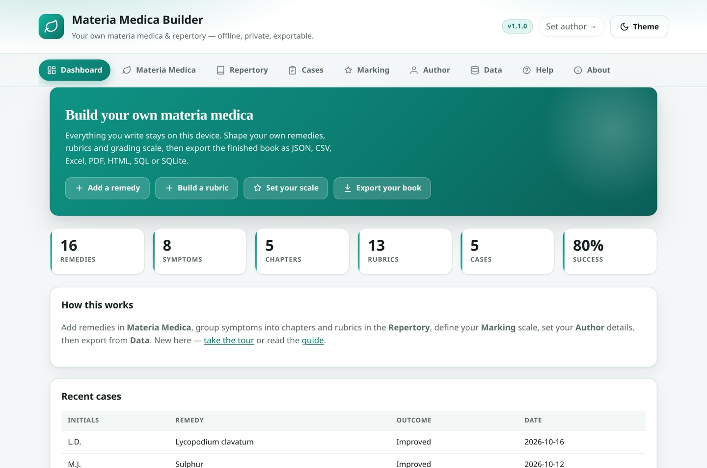

</div>

---

## 🕯️ Dedication

> **To the homeopaths of the past, the present and the future.**
>
> To those of the **past** — who sat with the sick through long nights and wrote down what they saw, symptom by symptom and remedy by remedy, so that what they learned would not be lost.
>
> To those of the **present** — who still take the whole case: the body, the mind, and the life around it; who keep this craft alive in a hurried world, and who teach it to whoever asks.
>
> To those of the **future** — who will inherit whatever we choose to record, and who will add their own careful observations to the record.
>
> And to anyone studying alone, with no teacher at hand and no one to compare notes with — may this make the work a little lighter.
>
> — *Dr Sohil Momin*

---

A single, self-contained Progressive Web App: no server, no account, no tracking, no CDN.

> **Vision:** help any individual practitioner assemble a personal materia medica and repertory — every remedy, symptom, rubric and grade defined and edited by hand — then publish or back it up in whatever shape they need.

## 🚀 Try it

**Live app → https://drsamonline.github.io/MATERIA-MEDICA-BUILDER/**

Open it in any modern browser, or install it (Chrome/Edge → install icon; iOS Safari → Share → *Add to Home Screen*) and it runs fully offline. A short guided tour runs the first time you open it, and can be replayed any time from the **Help** tab.

---

## 📸 A look around

<table>
<tr>
<td align="center" width="50%">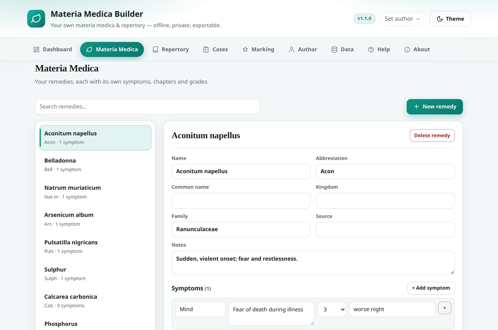<br><sub><b>Materia Medica</b> — remedies, symptoms, chapters and grades</sub></td>
<td align="center" width="50%">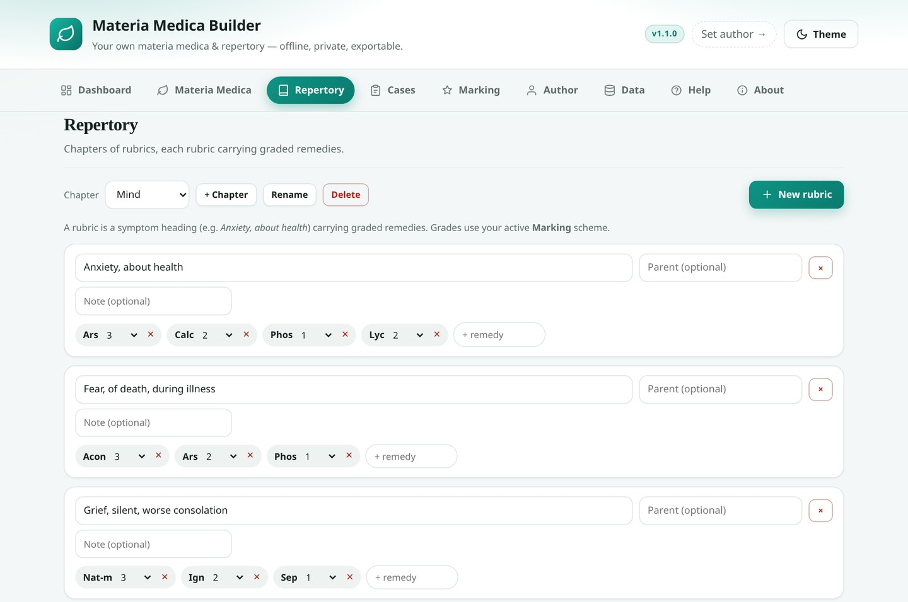<br><sub><b>Repertory</b> — rubrics carrying graded remedies</sub></td>
</tr>
<tr>
<td align="center" width="50%">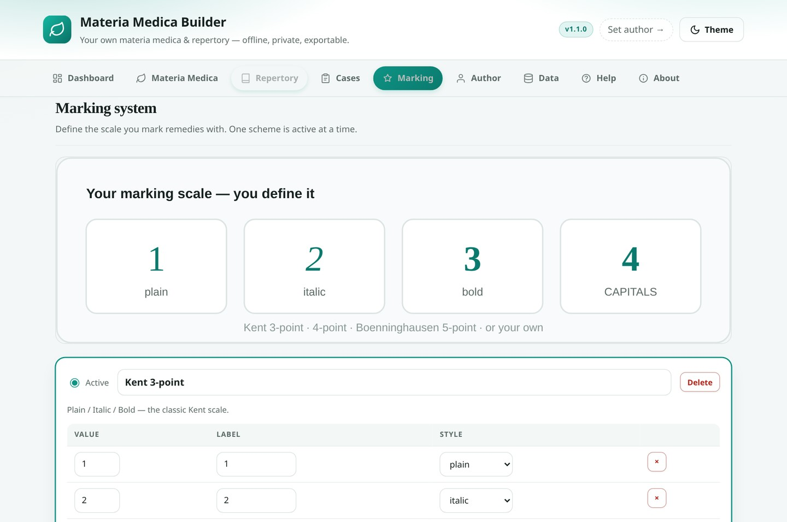<br><sub><b>Marking</b> — your own grading scale</sub></td>
<td align="center" width="50%">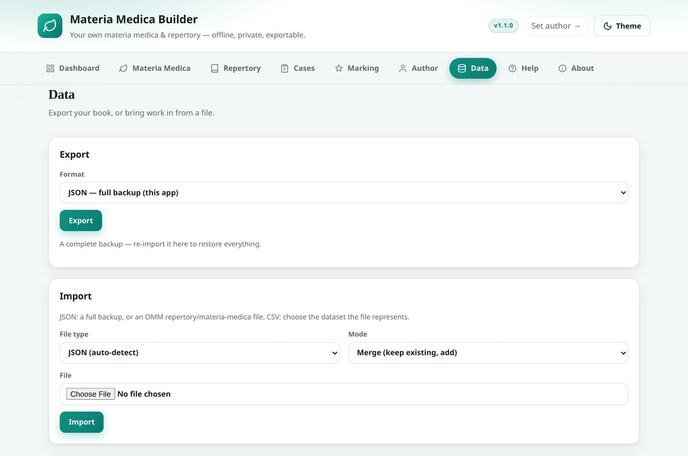<br><sub><b>Data</b> — export and import in eight formats</sub></td>
</tr>
<tr>
<td align="center" width="50%">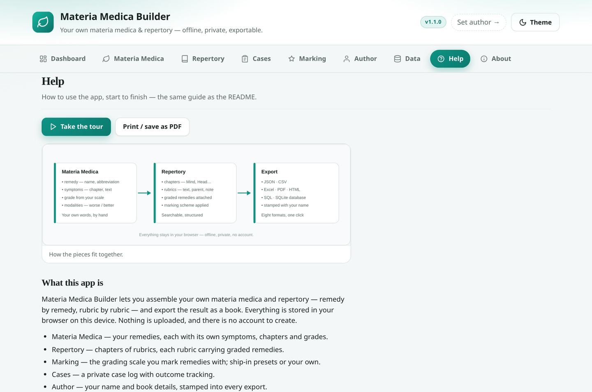<br><sub><b>Help</b> — the full guide, built in</sub></td>
<td align="center" width="50%">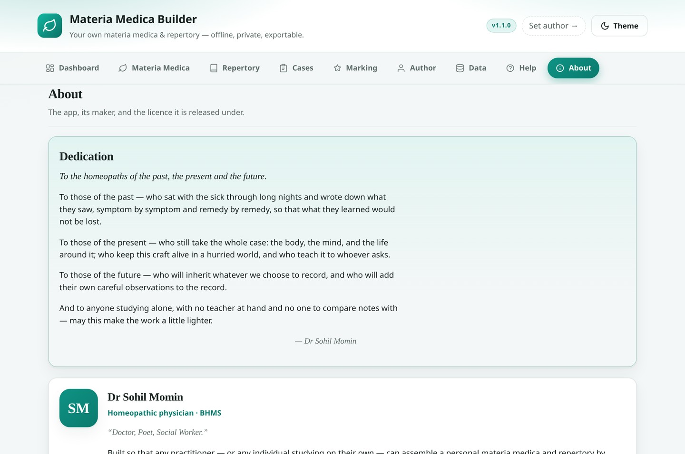<br><sub><b>About</b> — dedication, maker and licence</sub></td>
</tr>
<tr>
<td align="center" width="50%">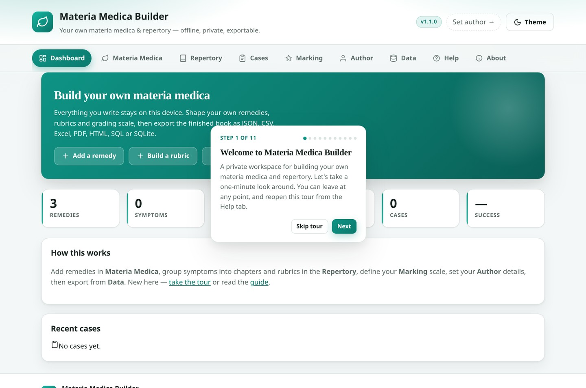<br><sub><b>First-run tour</b> — a guided walk through the app</sub></td>
<td align="center" width="50%">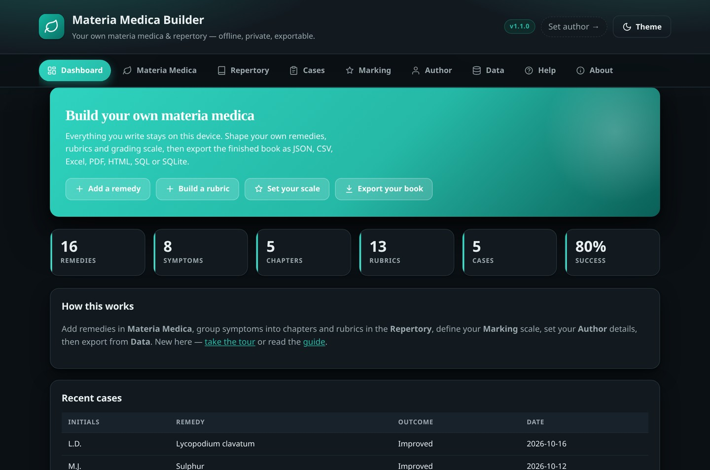<br><sub><b>Dark mode</b> — light, dark or follow the system</sub></td>
</tr>
</table>

---

## 🧭 How it fits together

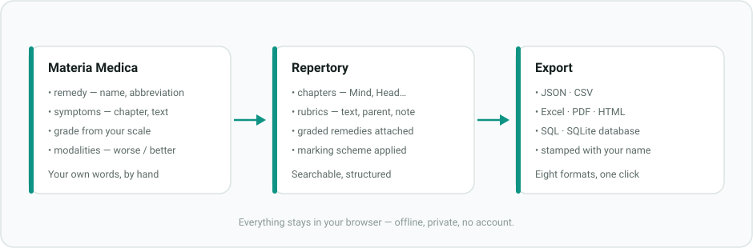

---

## ✨ What it does

| Area | What you get |
|---|---|
| **Materia Medica** | Remedies with name, abbreviation, common name, kingdom, family, source and notes. Add any number of symptoms to each, each with a chapter, grade and modalities. |
| **Repertory** | Chapters (Mind, Head, Stomach…) → rubrics → graded remedies. Rubrics support a parent heading and a note. |
| **Marking system** | Define the grading scale yourself. Four presets ship in, and you can edit any of them or add your own schemes. |
| **Author & branding** | Your name, credentials, clinic, email, website, book title, edition, year, copyright line and licence — stamped into every PDF, HTML file and workbook you export. |
| **Cases** | A private case logger: log a case, track the outcome (Cured / Improved / No Change / Aggravated / Suppressed) and review the history. |
| **Help** | The full how-to guide lives inside the app, plus a first-run tour and print-to-PDF. |
| **About** | The dedication, the maker, and the licence it is released under. |

Everything is stored **locally in your browser** (IndexedDB). Nothing is uploaded anywhere.

---

## 🎚️ Your marking scale

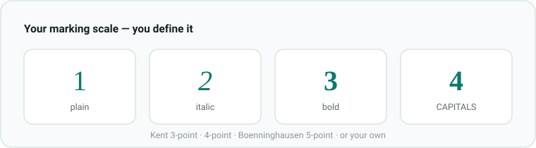

Four schemes ship in — **Kent 3-point**, **4-point with capitals**, **Boenninghausen 5-point** and a **Simple 0–2** — or press *New scheme* and define your own: any number of levels, each with a label and a style (plain / italic / bold / bold-italic / capitals / superscript). Rubrics everywhere use the active scheme, and every export renders the grades accordingly.

---

## 📖 How to use it

The same guide is built into the app — open the **Help** tab, or press **Take the tour**.

**Getting started**

1. Open the **Materia Medica** tab and add your first remedy (or edit the three starter remedies).
2. Give it an abbreviation — short forms like `Acon` or `Nat-m` are what the repertory shows.
3. Add symptoms to it: pick a chapter (Mind, Head, Stomach…), write the symptom, set a grade.
4. Open the **Repertory** tab, add a chapter, then add rubrics inside it.
5. Inside a rubric, type a remedy abbreviation and press Enter to attach it, then choose its grade.
6. Fill in your **Author** details, then go to **Data** and export your book.

**Building the repertory.** A rubric is a symptom heading such as *Anxiety, about health*. It may also have a parent heading (so *Morning* under *Sweat of the feet* reads as *Sweat of the feet, Morning*) and a note.

**Backups.** Your work lives only in this browser. Export a JSON backup regularly, and import it on another device to carry your project across.

---

## 📤 Export & import

| Format | Contents |
|---|---|
| **JSON — full backup** | Everything, re-importable here to restore the project. |
| **JSON — OMM** | Repertory and/or materia medica in the reader-app schema (v1.1). |
| **CSV** | All datasets as a zip, or one dataset at a time. |
| **Excel (.xlsx)** | A workbook: Info, Remedies, Symptoms, Repertory, Cases, Marking. |
| **PDF** | A printable book with your author block and copyright. |
| **HTML** | A self-contained, styled document you can open or host. |
| **SQL (.sql)** | Portable `INSERT` statements for SQLite, Postgres or MySQL. |
| **SQLite (.sqlite)** | A real database file (`meta`, `remedy`, `symptom`, `rubric`, `remedy_link`, `case_log`). |

**Import** accepts a full JSON backup, an OMM repertory or materia-medica file, or CSV — with **Merge** or **Replace** mode.

---

## 🔧 Under the hood

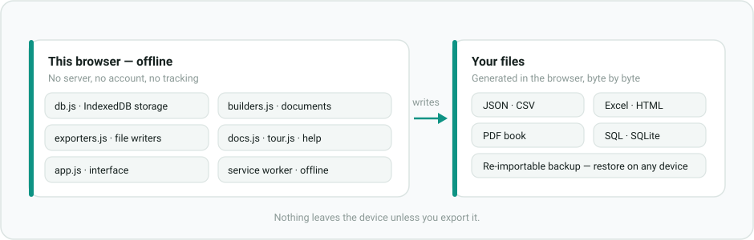

All writers are dependency-free and run entirely in the browser: the `.xlsx`, `.pdf` and `.sqlite` files are generated byte-by-byte in JavaScript, so the app never needs a network connection or a library from a CDN.

---

## 🔗 Compatibility with the OMM reader app

The JSON exports use the same envelope the reader app reads (`schema_version: "1.1"`, `type: "repertory"` / `"materia_medica"`, a `book` provenance block, and `sections → rubrics → remedy_table` / `remedies → symptoms`). A repertory built here drops straight into that collection, and a book extracted by the OMM pipeline can be imported here for editing.

---

## 🛠️ Running it locally

```bash
python3 -m http.server 8080     # then open http://localhost:8080
```

Deploy anywhere static — GitHub Pages, Netlify, Cloudflare Pages. The service worker takes it offline automatically.

---

## 🧱 Data model

```
remedy   { id, name, abbrev, common_name, kingdom, family, source, notes }
symptom  { id, remedy_id, chapter, text, grade, modalities[{dir,text}], notes }
section  { id, title, order }
rubric   { id, section_id, text, parent, note, remedies[{remedy_id, grade, polarity, note}] }
case     { id, patient_initials, age, gender, chief_complaint, prescribed_remedy_id,
           potency, dosage, outcome, follow_up_notes, date }
settings { author{…}, marking{active, schemes[{id,name,levels[{v,label,style}]}]} }
```

`grade` is a level value from the active marking scheme. `polarity` is `+` (default) or `-` (antidotal).

**Upgrading from v1:** the app opens the same `MateriaMedicaDB` database at version 2 and adds the new stores — existing remedies, symptoms and cases are preserved and old symptom fields are migrated automatically.

---

## 📁 Files

```
index.html            app shell and tabs
css/styles.css        all styling (no framework)
js/app.js             UI wiring and events
js/db.js              IndexedDB layer, marking schemes, migration, starter data
js/builders.js        turn stored data into export documents
js/importers.js       parse native/OMM JSON and CSV
js/exporters.js       the dependency-free XLSX / PDF / SQLite / CSV / SQL / HTML writers
js/docs.js            the in-app Help guide, dedication, maker details and licence
js/diagrams.js        inline SVG artwork used inside the app
js/tour.js            the first-run spotlight tour
docs/workflow.svg     diagram — how the pieces fit together
docs/architecture.svg diagram — browser-only architecture
docs/marking-scale.svg diagram — the grading scale
docs/screenshots/     the screenshots used above
sw.js                 offline service worker
manifest.json         PWA manifest
icons/                app icons
LICENSE               Free Use Licence (attribution required)
```

---

## 👤 About the maker

**Dr Sohil Momin, BHMS** — homeopathic physician. *Doctor, Poet, Social Worker.*

Built so that any practitioner — or anyone studying on their own — can assemble a personal materia medica and repertory by hand, keep it entirely private, and publish or back it up in whatever form they need.

- GitHub: [@drsamonline](https://github.com/drsamonline)
- Email: [sohilmomin2000@gmail.com](mailto:sohilmomin2000@gmail.com)
- Web: [drsamonline.github.io](https://drsamonline.github.io/)

The same details appear in the app's **About** tab, together with the dedication above.

---

## 📄 Licence

**Free Use Licence (Attribution Required)** — © 2026 Dr Sohil Momin.

**Free to use and distribute with author mention.** You may use, copy, modify, merge, publish, distribute, sublicense and/or sell copies of this software, provided that:

1. the copyright notice and licence are included in all copies or substantial portions, and
2. any use, distribution or derivative work clearly credits the author — **Dr Sohil Momin**, with a link to <https://github.com/drsamonline> — in its interface, documentation or about screen.

The software is provided “as is”, without warranty of any kind. Your own data — remedies, symptoms, rubrics, cases and any book you compile — belongs to you. The full text is in [LICENSE](LICENSE) and in the app's **About** tab.

---

## 🔒 Privacy

No authentication, no cloud, no analytics, no external requests after load. Clearing your browser data will erase the project — export a backup regularly.
